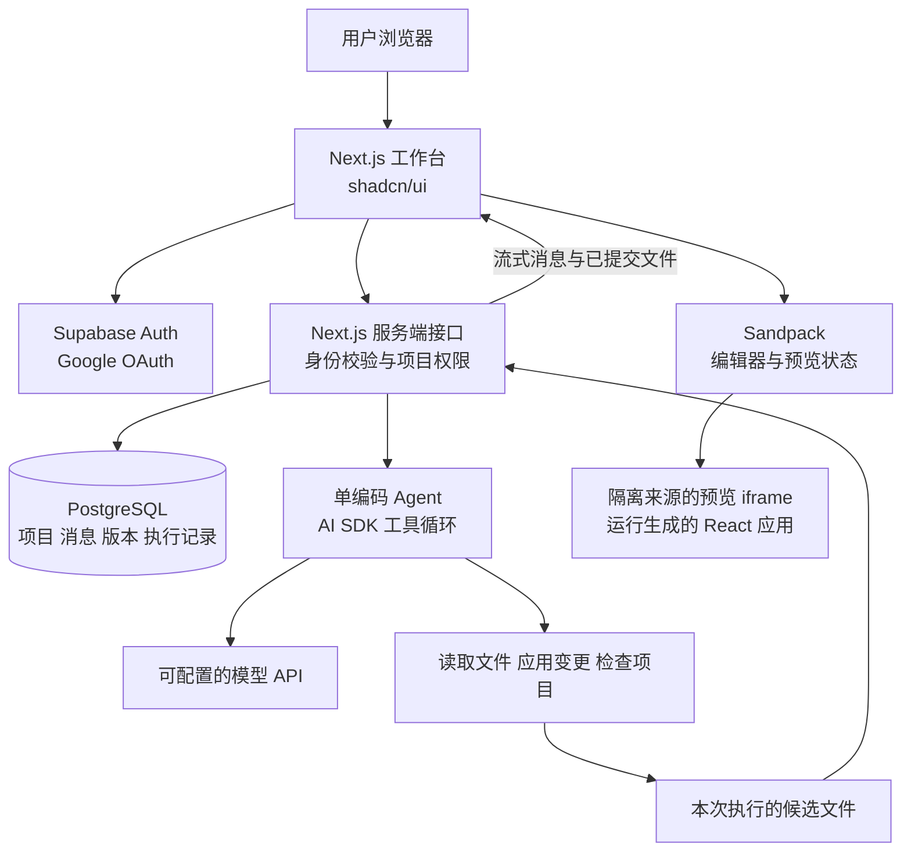

# Atoms Demo 第一版架构设计

设计日期：2026 年 10 月 20 日  
状态：2026-10-20 的架构草案，保留最初选型与取舍，非当前功能清单。

2026-10-21 更新：现已实现云端队列、同区域 Vercel/Supabase 与本机 Codex Worker；项目重命名、导出及部分草案能力未实现。实际状态以 [交付说明](docs/DELIVERY.md)、[运行指南](README.md) 为准。

## 目标与范围

第一版做一个可在线体验的 AI 应用生成工作台：用户用 Google 登录，描述需求，由一个编码 Agent 生成 React 应用，在网页中预览和编辑，通过对话继续修改，重新打开时能恢复项目。

用户已提出的方向：Google 登录、单 Agent、数据库持久化、shadcn/ui、代码编辑器和产物预览。

题目要求真实交互、持久化、在线访问链接和 GitHub 源码，建议覆盖基本流程及至少一个延展能力。第一版将**版本历史与一键恢复**纳入交付范围，作为明确可演示的延展能力。

**生成能力边界：生成有实际交互的 React 前端应用。** 本平台自身有登录、服务端与数据库；生成的产物暂不支持任意后端、数据库建表、服务器密钥或任意命令执行。适合生成待办、看板、表单、计算器和展示型仪表盘。该边界符合题目文字中的应用生成与可视化展示要求，需在交付说明中明确。

## MVP 功能与验收

| 模块 | 第一版交付 | 验收方式 |
| --- | --- | --- |
| 登录 | Google OAuth，首次登录自动创建账号，退出登录，会话恢复 | 登录后进入项目页，退出后受保护接口不可访问 |
| 项目管理 | 创建、列表、打开、重命名 | 关闭后重新打开能找到自己的项目 |
| Agent | 一个编码 Agent，真实模型调用，流式回复，实际工具步骤，增量修改 | 连续提出两轮不同需求，应用功能确实发生变化 |
| 数据持久化 | 项目、消息、当前文件、执行记录、版本存入 PostgreSQL | 换浏览器登录后仍能打开相同源码与对话 |
| 工作台 | shadcn/ui，清晰的空态、生成态、失败态与保存状态 | 用户能看懂当前在生成、保存还是运行 |
| 代码编辑 | 文件树、语法高亮、多文件查看、手动修改、显式保存 | 改文字或逻辑后预览更新，保存后刷新仍存在 |
| 产物预览 | 可点击的 React 应用，重新运行、桌面和手机宽度切换、错误展示 | 表单、筛选、添加删除等真实交互可操作 |
| 延展能力 | 版本列表、历史预览、恢复为新版本 | V1 → V2 → 恢复 V1 的代码为 V3，旧版本仍保留 |
| 交付 | 在线 Demo、GitHub 仓库、配置说明、功能边界与测试说明 | 评审可从在线入口完成完整流程 |

第一版不纳入多人协作、多 Agent 编排、通用云 IDE、第三方连接器、可视化拖拽编辑器、计费、自动 GitHub 同步和每个生成应用的独立部署。

题目要求的是 Demo 本身有在线链接。生成应用独立部署属于后续功能，不是本次原文明确要求。

## 推荐技术栈

| 层 | 选择 | 取舍 |
| --- | --- | --- |
| Web 与服务端 | Next.js App Router、React、TypeScript，Node.js runtime | 一个仓库承载页面、登录回调和流式接口 |
| 界面 | Tailwind CSS、shadcn/ui、Lucide | 复用组件源码，统一布局、主题和交互状态 |
| 登录与数据库 | Supabase Auth、Supabase PostgreSQL、supabase-js、SSR 集成 | 复用 Google 登录、会话和数据库能力，少接一套认证系统 |
| Agent | Vercel AI SDK 的工具循环与 UI 流、Zod | 实现单 Agent 的工具调用、流式消息、参数校验和步骤限制 |
| 编辑与预览 | @codesandbox/sandpack-react | 同一文件状态驱动 CodeMirror 编辑器、文件树和运行预览 |
| 源码检查 | TypeScript compiler API 或轻量 TSX 解析器 | 做语法诊断、文件引用与依赖规则检查，不执行生成源码 |
| 版本保存 | PostgreSQL JSONB 全量文件快照 | 小项目易实现、易恢复，暂不引入 Git 服务 |
| 测试 | Vitest、Playwright | 验证文件变更、版本提交和关键用户路径 |
| 部署 | 默认 Next.js 托管部署，Supabase 托管数据库 | 部署前核对流式请求与函数时长；必要时使用常驻 Node 容器 |

复用开源组件不等于所有依赖服务免费。模型调用、Supabase 托管和部署平台按实际账户条件使用；模型通过适配器和环境变量配置，不在架构中绑定某个厂商或价格。

实施时锁定一组实际验证过的依赖版本与 lockfile，先完成 Next.js、React、Sandpack、AI SDK 的兼容性冒烟测试。

官方依据：

- [shadcn/ui](https://ui.shadcn.com/docs)：可直接使用与修改的组件源码。
- [Supabase Google 登录](https://supabase.com/docs/guides/auth/social-login/auth-google)、[Next.js 集成](https://supabase.com/docs/guides/auth/quickstarts/nextjs)。
- [AI SDK ToolLoopAgent](https://ai-sdk.dev/docs/reference/ai-sdk-core/tool-loop-agent)：支持多步工具调用与流式结果。
- [Sandpack 组件](https://sandpack.codesandbox.io/docs/advanced-usage/components)：提供 CodeMirror 编辑器、文件树、预览和控制台。

## 系统架构



平台服务端处理认证、模型调用和数据保存；生成的应用在预览环境里运行。模型 API key 和平台认证凭据不进入生成文件，也不传给预览 iframe。

MVP 无后台队列和独立 Worker。生成绑定当前请求生命周期，用户关闭页面后不承诺任务继续运行。数据库记录已完成消息及执行状态，超时或中断可重新发起。

## 页面与交互

### 登录页和项目页

登录页只放 Google 登录、产品说明与示例。OAuth 首次登录就是注册，无需另建注册表单。

项目页包含新建输入框、三个示例需求以及项目卡片。示例只用于填充需求；提交后调用真实模型。

### 项目工作台

顶栏显示项目名称、保存状态、版本入口。左侧为对话，右侧为 Preview / Code 两个页签。

- 对话区展示用户消息、Agent 回复、真实工具调用状态与完成后的版本卡片。
- Code 页包含文件树和编辑器。
- Preview 页包含应用预览、设备宽度切换、刷新和错误提示。
- 历史版本在侧边面板选择，可先预览再恢复。

生成期间继续显示上一个版本，并标注“正在生成新版本”。代码工具完成完整文件变更后才更新候选内容，不将半截代码直接替换到正在运行的预览。

编辑器即时改变本地预览，点击保存后提交数据库。未保存时发起 Agent 请求，必须先保存成功，再使用这个版本作为 Agent 的基线。生成期间暂停手动编辑和恢复操作，服务端仍需处理多标签页冲突。

### 美观度实现

平台使用 shadcn/ui 的 Button、Card、Tabs、Dialog、Sheet、ScrollArea、Resizable 等必要组件，统一字号、间距、边框、留白与主题，不增加大量低价值装饰。

生成应用与平台是两套运行环境。第一版生成应用用 React、TypeScript 和普通 CSS，并预置设计变量与基础样式；提示中约束布局、配色、空态和响应式设计。平台使用 shadcn/ui 不会自动让生成应用拥有相同组件。

如果确实需要生成应用也使用 shadcn/ui，应先把一个经过 Sandpack 验证的有限组件集合、样式和依赖打包进模板，再开放给 Agent。该项排在基础生成链路稳定之后。

## 单 Agent 如何工作

使用一个编码 Agent，工具循环处理新建与修改任务。初始实现提供三个工具：

| 工具 | 职责 |
| --- | --- |
| read_files | 读取指定项目文件，返回路径和内容 |
| apply_changes | 使用结构化参数新增或完整替换指定文件、删除允许删除的文件 |
| validate_project | 检查必需文件、路径、TSX 语法和允许的依赖引用，返回具体错误 |

文件少时直接提供当前文件树和关键文件，修改时让 Agent 读取相关文件。完整替换单个文件比第一版实现通用补丁解析更可靠。限定单次文件数、文件大小和工具步骤；超限返回明确错误。

执行流程：

1. 校验登录态、项目归属、请求幂等键和当前项目 revision。
2. 保存用户消息，创建 run，取得项目生成锁。
3. 从已保存工作文件复制候选文件，构造需求、上下文和工具。
4. Agent 读取文件、应用修改、调用检查；检查失败可在有限步骤内修正。
5. 服务端最后再强制检查一次，不依赖模型是否主动调用检查工具。
6. 检查通过后，在事务中保存新版本、工作文件、最终消息和 run 状态。
7. 前端收到已提交版本后交给 Sandpack 编译运行。

建议初始上限：每轮最多 8 个工具循环步骤，候选文件总量约 300 KB、最多 20 个可编辑文件；实际请求超时按部署条件设置并测试。这些是产品限制建议，不是模型或组件的固定限制。

**源码检查通过只代表通过了静态规则，不等于应用正确运行或业务测试通过。** Sandpack 的编译与运行错误在预览区展示，用户可将错误带回同一个 Agent 请求修复。自动运行浏览器并自我修复排在后续阶段，不在 MVP 中假装已完成。

恢复旧版本后，下次 Agent 以恢复后的文件为准。保留对话供用户阅读，但在模型上下文明确标注恢复事件，避免后续对话把已撤销功能重新当成当前状态。

## 编辑器和预览方案

首选 SandpackCodeEditor、SandpackFileExplorer、SandpackPreview，共用 SandpackProvider 和文件映射。内置编辑器基于 CodeMirror，第一版已经覆盖代码编辑需求，不必再同时集成 Monaco。

预览模板固定为经过验证的 React TypeScript 模板，预装并锁定允许使用的依赖。基础版本只开放 React、React DOM 和验证过的图标包等少量依赖，Agent 不直接改包管理配置或任意安装软件。

Sandpack 使用在线 bundler，部署前须从评审可能使用的网络验证可达性。其代码编辑组件与依赖包可开源复用，但默认预览仍依赖外部运行服务。若不可达，评估自托管 bundler，不能声称完全离线运行。

安全边界：预览与平台保持跨来源隔离，使用组件支持的 iframe 限制；确认弹窗与顶层导航行为，校验消息来源和实例标识。平台凭据不进入生成应用，生成文件不在平台 Node 进程中 eval 或执行。浏览器预览不会提供服务端任意命令执行能力。

| 方案 | 第一版判断 |
| --- | --- |
| Sandpack | 首选；直接覆盖编辑和前端运行预览 |
| Monaco + 自建预览 | 需要额外处理编译、文件同步和运行错误，第一版收益较小 |
| WebContainers | 支持浏览器内 Node.js，适合更完整开发环境；本版范围不需要该复杂度 |
| E2B 云沙箱 | 后续支持后端、终端和构建执行时评估；会增加运行环境管理与成本 |

来源：[Sandpack 文档](https://sandpack.codesandbox.io/docs)、[自托管 bundler](https://sandpack.codesandbox.io/docs/guides/hosting-the-bundler)、[WebContainers](https://webcontainers.io/guides/introduction)、[E2B](https://docs.e2b.dev/)。

## 数据库设计

使用 Supabase 的 auth.users 作为用户来源，应用增加四张表。

| 表 | 主要字段 | 用途 |
| --- | --- | --- |
| projects | id、owner_id、name、working_files JSONB、revision、head_version_id、active_run_id、created_at、updated_at | 当前已保存工作状态和项目归属 |
| messages | id、project_id、run_id、role、parts JSONB、created_at | 用户消息、Agent 文本、工具结果与系统事件 |
| versions | id、project_id、number、files JSONB、summary、source、restored_from_id、created_at | 不可变的完整源码快照 |
| runs | id、project_id、request_key、base_revision、status、expires_at、error、created_at、finished_at | 幂等、并发控制与执行状态 |

source 取 ai、manual、restore。文件映射示意：`{ "/App.tsx": "...", "/styles.css": "..." }`。预置只读模板通过 template_version 标识，版本加载时必须恢复对应模板与依赖配置，避免历史版本因默认模板更新而变化。

数据库约束与提交：

- versions 的 project_id 与 number 组合唯一；runs 的 project_id 与 request_key 组合唯一。
- 提交通过数据库事务函数完成，锁定 project 行，验证 owner、base_revision 与 active_run_id。
- 同一事务写版本、更新 working_files 与 head_version_id、递增 revision、更新 run 和最终消息。
- 手动保存和恢复也走相同提交规则。并发冲突返回 409，提示重新加载，不能覆盖别人或另一标签页的新内容。
- 中断或失败不替换最后保存的文件。到期 run 在后续请求中标记失效；迟到的执行结果必须因锁或 revision 不符而拒绝提交。
- 所有表启用 RLS；子表通过 project 归属校验。面向用户的操作使用用户身份；读取通过 RLS；事务写入使用固定 search_path 的 SECURITY DEFINER 函数，每个函数显式验证 auth.uid() 和项目归属，并限制执行授权，禁止直接写表。

不依赖前端传入的 owner_id，不因使用 Supabase 就省略服务端权限校验。

来源：[Supabase Row Level Security](https://supabase.com/docs/guides/database/postgres/row-level-security)。

### 持久化的两个层次

1. **本平台的数据**：项目、对话、文件和版本可靠保存到数据库，是本次 MVP 的持久化承诺。
2. **生成应用的业务数据**：第一版默认 React 状态；若使用 localStorage，也只作为明确标注的浏览器本地能力，不承诺跨设备、跨项目隔离或长期可靠保存。预览环境的存储行为需要验证，不能自动等同于平台数据库。

为每个生成应用提供独立业务数据库、认证和后端接口，属于下一阶段。演示时明确区分“保存了代码项目”和“保存了待办等业务数据”。

## 延展能力选择

**选择版本历史与一键恢复。**

用户让 AI 改了页面后，希望比较或撤销，这是生成产品中的直接需求。实现可复用现有数据库文件快照，不新增运行环境或外部授权。

功能流程：V1 首次生成 → V2 对话修改 → 只读预览 V1 → 恢复为 V3。V1 和 V2 均保留，恢复有明确来源，当前项目继续从 V3 修改。恢复仅恢复源码，不宣称恢复业务数据。

不把登录、数据库或编辑器包装成延展能力；它们属于当前已确定的核心范围。

后续优先级：运行错误一键修复 → 源码 ZIP 导出 → 生成应用分享发布 → 云沙箱支持后端。ZIP 导出成本较低，有余量时可以提前加，但不挤占核心验收时间。

## 接口与模块边界

| 接口 | 职责 |
| --- | --- |
| GET /auth/callback | 完成登录回调 |
| GET /api/projects | 当前用户项目列表 |
| POST /api/projects | 创建项目 |
| GET /api/projects/:id | 项目、文件与对话 |
| PATCH /api/projects/:id | 项目重命名 |
| POST /api/projects/:id/chat | 创建 run 并返回 AI SDK 流式响应 |
| POST /api/projects/:id/save | 保存人工编辑并创建版本 |
| GET /api/projects/:id/versions | 版本摘要列表 |
| GET /api/projects/:id/versions/:versionId | 指定版本文件 |
| POST /api/projects/:id/restore | 将历史版本恢复成新版本 |
| GET /api/projects/:id/runs/:runId | 刷新或断线后查询执行结果 |

所有项目接口验证用户与项目归属。版本列表不一次性返回全部源码，选择版本时再获取。

建议目录：

```text
app/                  页面、认证回调与 API
components/workspace/ 聊天、版本、编辑器和预览
components/ui/        shadcn/ui 组件
lib/agent/            单 Agent、工具和上下文构建
lib/projects/         文件规则与版本提交
lib/supabase/         服务端和浏览器客户端
lib/templates/        固定 React 模板和设计变量
supabase/migrations/  数据表、RLS 与事务函数
tests/                核心规则与端到端流程
```

## 开发顺序与时间预算

以下是 6–8 小时专注开发的目标预算，不包含等待外部账号开通或 OAuth 审核。

| 阶段 | 预算 | 结果 |
| --- | --- | --- |
| 运行链路验证 | 0.5 h | Sandpack 模板可运行，模型工具调用可用，确定部署时长条件 |
| 登录和项目数据 | 1.0 h | Google 登录、数据表、RLS、项目列表 |
| 工作台和文件保存 | 1.0 h | shadcn/ui 布局、编辑器、预览、手动保存 |
| Agent 核心链路 | 2.0 h | 真实生成、流式步骤、增量修改、检查与错误处理 |
| 版本延展能力 | 0.75 h | 版本列表、旧版预览和恢复 |
| 验证与部署 | 1.25 h | 主流程、权限与失败场景验证，在线访问 |
| 文档和缓冲 | 1.0 h | README、功能取舍、演示说明与修复 |

超时时先削减装饰、设备切换或额外导出，保留真实生成、持久化、版本恢复及在线交付。

## 验收与外部准备

主要验收路径：Google 登录 → 新建待办应用 → 添加和完成任务 → 对话增加筛选 → 手改标题并保存 → 刷新确认源码和消息保留 → 预览旧版本 → 恢复 → 继续修改。

另外验证：其他账号无法读取项目；重复提交不会产生重复版本；两标签页并发保存不会覆盖；模型超时和错误源码不会丢失已保存版本；新请求能处理过期 run；历史版本预览不会改动当前文件。

开始实现所需配置：

- Google OAuth Client ID 和 Secret，配置 Google 到 Supabase 的回调，以及 Supabase 到应用的允许跳转地址。若 Google 应用处于测试状态，提前确认评审账号的访问条件。
- Supabase 项目与数据库迁移权限。
- 一个支持工具调用和流式响应的模型 API 配置。
- 部署账号与稳定访问域名；验证登录回调、模型连通性和 Sandpack 预览可达性。

密钥通过部署环境变量配置，不写进源码或生成产物。无真实配置时只能完成界面与本地开发，不能把模拟生成标记为已满足验收。

部署平台可能限制函数运行时长，Next.js 配置本身不会取消平台限制。上线前做一次完整长请求验证。来源：[Next.js Route Segment Config](https://nextjs.org/docs/app/api-reference/file-conventions/route-segment-config)。


## 首版实现补充（2026-10-20）

已落地代码与启动步骤以 README.md 为准。数据库读取通过 RLS 隔离用户；写入通过固定 search_path 的 SECURITY DEFINER RPC，逐个验证身份、所有权、revision 和生成锁。没有开放直接写表权限。文件树仅展示业务文件，编辑与预览使用 Sandpack/CodeMirror。运行入口与依赖配置由平台控制。无外部配置时开放明确标注的 /demo 示例；真实登录、云端持久化和模型调用需要环境变量后联调。
